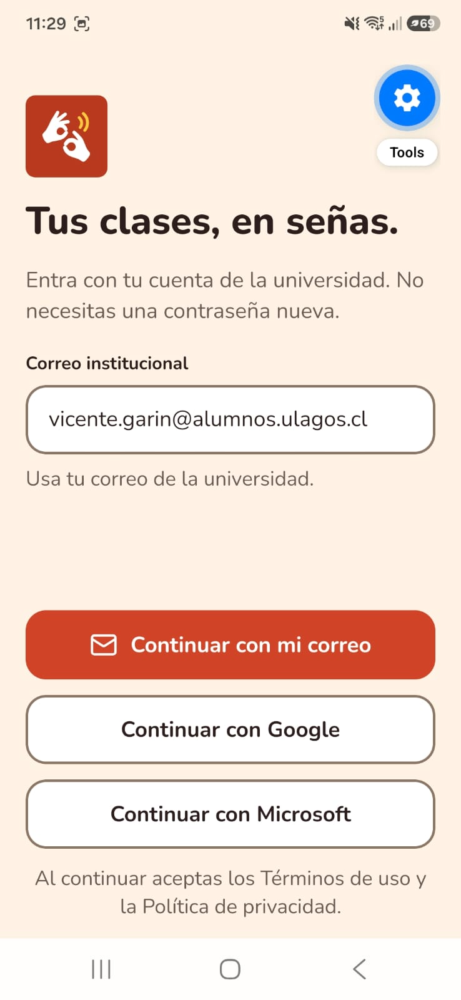
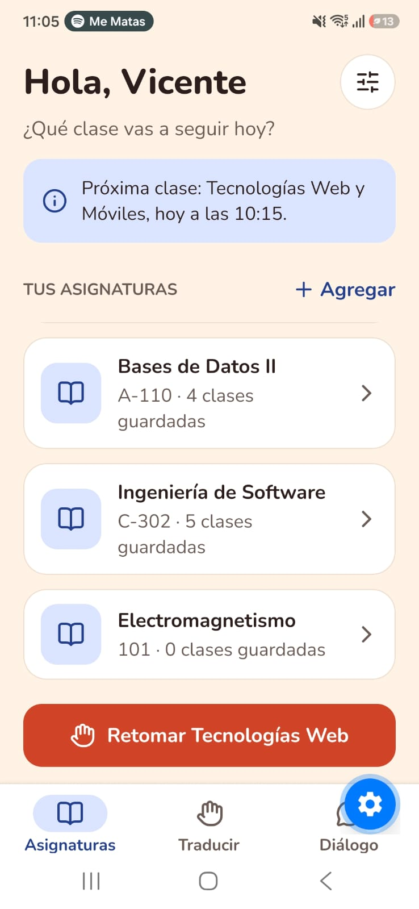
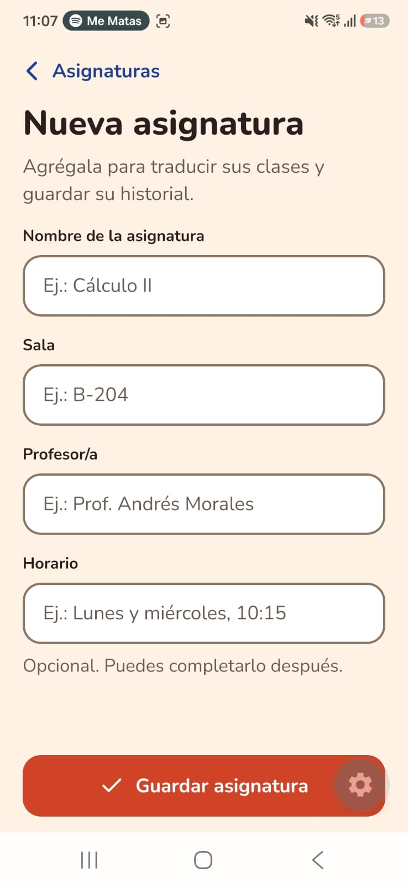
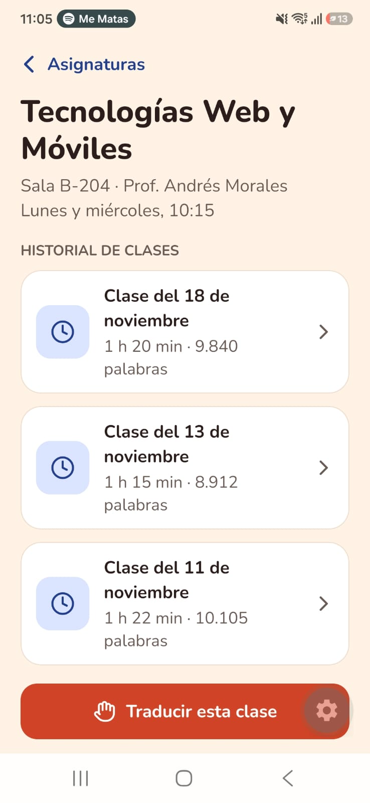
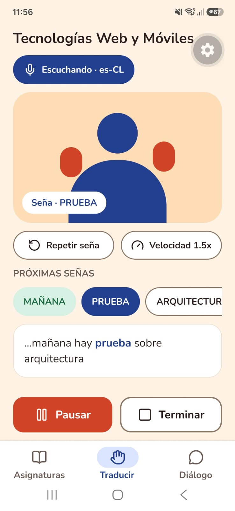
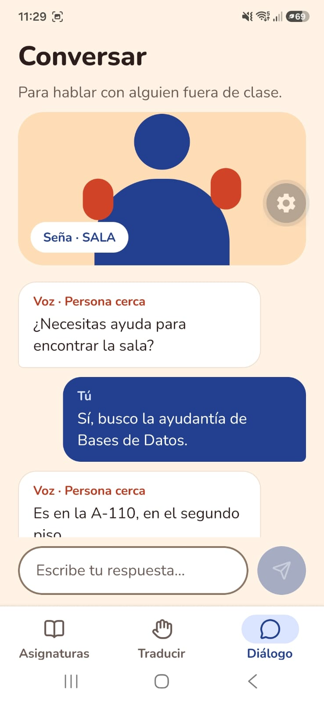
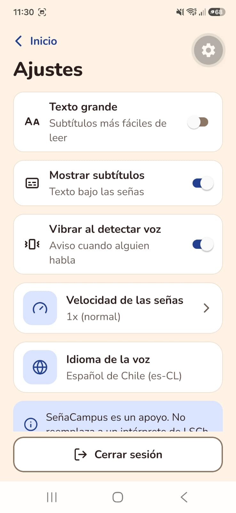

# SeñaCampus — Asistente Móvil de Interpretación Académica en Tiempo Real

Aplicación móvil desarrollada en **React Native con Expo (SDK 58)** para apoyar la inclusión de estudiantes sordos o hipoacúsicos en aulas universitarias. Escucha la explicación del docente y la muestra en **Lengua de Señas Chilena (LSCh)** junto con subtítulos, organizada por asignatura. Es un apoyo: no reemplaza a un intérprete de LSCh.

> **Proyecto académico:** Avance N°1 — Diseño UI/UX y Frontend Móvil
> **Asignatura:** Tecnologías Web y Móviles (6º semestre) — Ingeniería Civil en Informática, Universidad de Los Lagos
> **Autor:** Vicente Martín Garín Pereda

---

## Entregables del Avance N°1

* **Bitácora de diseño y frontend:** [docs/bitacora.md](./docs/bitacora.md)
* **Diseño y prototipo en Figma:** [señaCampus en Figma](https://www.figma.com/design/bCv8y8gXMaHy6oLUagS4PI/se%C3%B1aCampus?node-id=3-362&t=3c6s7hihCM2XMi2I-1)

---

## Stack tecnológico

* **Framework móvil:** React Native + Expo SDK 58 (probado en Expo Go)
* **Navegación:** Expo Router (`src/app/`) con layout raíz en pila, pestañas inferiores y rutas dinámicas (`asignatura/[id]`, `clase/[id]`)
* **Estado:** hooks de React (`useState`, `useEffect`, `useRef`), estado compartido con Context (`ClasesContext`) y datos de ejemplo en `src/data/mockData.js`
* **Componentes nativos:** `FlatList` (listas), `Pressable` (toques con estado presionado), `TextInput` controlado, `Modal`, `Switch`, `SafeAreaView` / `useSafeAreaInsets`
* **Diseño:** colores, tipografía (Nunito) y medidas centralizados en `src/constants/`, iguales a los estilos del Figma; íconos `lucide-react-native`; logo SVG con `react-native-svg`
* **Backend:** Node.js + Express + Mongoose, MongoDB en Docker; cliente HTTP preparado en `mobile/src/services/api.js`

---

## Estructura del proyecto

    SenaCampus/
    ├── docs/
    │   ├── bitacora.md
    │   └── img/                     # Capturas de Figma y de la app
    ├── docker-compose.yml           # MongoDB persistente en Docker
    ├── server/                      # Backend: Node.js + Express + Mongoose
    │   ├── .env                     # Puerto y conexión a MongoDB (no se sube a GitHub)
    │   ├── scripts/
    │   │   └── seedDictionary.js    # Carga los 2.098 términos del Diccionario LSCh
    │   └── src/
    │       ├── server.js            # Punto de entrada: Express, CORS, puerto 5000
    │       ├── config/db.js         # Conexión a MongoDB
    │       ├── models/              # Gloss.js, Session.js, Subject.js
    │       ├── controllers/         # translationController.js, subjectController.js
    │       ├── routes/              # translationRoutes.js, subjectRoutes.js
    │       └── utils/textParser.js  # Normaliza texto y quita conectores
    └── mobile/
        ├── app.json                 # Nombre, ícono y pantalla de carga
        ├── assets/                  # logo.svg, icon.png, splash-icon.png, adaptive-icon.png
        └── src/
            ├── app/
            │   ├── _layout.jsx          # Pila raíz + carga de la fuente Nunito
            │   ├── index.jsx            # Acceso con correo institucional
            │   ├── ajustes.jsx          # Ajustes de accesibilidad
            │   ├── resumen.jsx          # Resumen al terminar la clase
            │   ├── nueva-asignatura.jsx # Formulario para crear una asignatura
            │   ├── asignatura/[id].jsx  # Detalle de asignatura e historial
            │   ├── clase/[id].jsx       # Transcripción guardada
            │   └── (tabs)/
            │       ├── _layout.jsx      # Barra de pestañas
            │       ├── index.jsx        # Asignaturas (inicio)
            │       ├── traducir.jsx     # Elegir clase y traducirla en vivo
            │       └── dialogo.jsx      # Modo diálogo
            ├── components/              # Aviso, BarraSuperior, Boton, Burbuja, CampoTexto, Chip,
            │                            # FilaAjuste, Logo, Tarjeta, VentanaConfirmacion, VisorSenas
            ├── constants/               # colores.js, medidas.js, tipografia.js
            ├── context/                 # ClasesContext.jsx (asignaturas y clases compartidas)
            ├── data/                    # mockData.js
            └── services/                # api.js

---

## Backend y base de datos

El backend ya está implementado y queda listo para conectarse a la app en el siguiente avance (en el Avance N°1 la app usa datos de ejemplo, como permite la rúbrica).

* **Base de datos:** MongoDB en Docker (`docker-compose.yml`) con volumen persistente.
* **Corpus LSCh:** 2.098 términos cargados desde el *Diccionario Bilingüe Lengua de Señas Chilena – Español* (UMCE), distinguiendo señas con recurso visual y términos que se deletrean (dactilología).
* **Motor de traducción:** `textParser.js` normaliza el texto y quita conectores que no se señan en LSCh («el», «la», «de», «hay»); `translationController.js` revisa primero frases compuestas («sala de clases») y luego palabras sueltas.
* **API REST:** `POST /api/v1/traductor/parse` devuelve la secuencia de glosas o letras; también hay rutas CRUD de asignaturas.

## Requisitos y ejecución local

### Requisitos previos
* **Node.js:** v20 LTS o superior
* **Expo Go:** instalado en un teléfono Android o iOS, compatible con **SDK 58** (o 57)
* El teléfono y el computador deben estar en la misma red Wi-Fi

### Pasos para ejecutar
1. **Clonar el repositorio:**
   `git clone https://github.com/Vicente-Garin/SenaCampus.git && cd SenaCampus/mobile`
2. **Instalar dependencias:**
   `npm install`
3. **Iniciar el servidor de desarrollo:**
   `npx expo start -c`
4. **Abrir en el teléfono:** escanear el código QR de la terminal con **Expo Go** (Android) o con la cámara (iOS).

### Backend (opcional en este avance)
Requiere **Docker Desktop**. Desde la raíz del repositorio:

    docker-compose up -d
    cd server
    npm install
    node scripts/seedDictionary.js   # solo la primera vez
    npm run dev                      # API en http://localhost:5000

---

## Capturas

| Acceso | Asignaturas | Nueva asignatura | Detalle de asignatura |
| :---: | :---: | :---: | :---: |
|  |  |  |  |

| Traducción en clase | Modo diálogo | Ajustes |
| :---: | :---: | :---: |
|  |  |  |
