# Bitácora de Diseño UI/UX y Frontend Móvil — SeñaCampus

* **Asignatura:** Tecnologías Web y Móviles (6º semestre) — Ingeniería Civil en Informática, Universidad de Los Lagos
* **Estudiante:** Vicente Martín Garín Pereda
* **Avance:** Avance N°1 — Diseño UI/UX y Frontend Móvil (React Native + Expo SDK 58)
* **Repositorio:** [GitHub — SenaCampus](https://github.com/Vicente-Garin/SenaCampus)
* **Archivo de Figma:** [señaCampus en Figma](https://www.figma.com/design/bCv8y8gXMaHy6oLUagS4PI/se%C3%B1aCampus?node-id=3-362&t=3c6s7hihCM2XMi2I-1) — páginas `00 · Identidad y UI Kit`, `01 · Wireframes, storyboard y flujo` y `02 · Alta fidelidad y prototipo` (para navegar, presionar ▶ Play en la página 02; el flujo empieza en «1 Splash»).

---

## 1. Identidad de Marca y UI Kit Base

### Nombre y propósito
**SeñaCampus** une la **Lengua de Señas Chilena (LSCh)** con el **campus** universitario. La app escucha la voz del profesor en clases y la muestra en señas y subtítulos para estudiantes sordos o hipoacúsicos. Es un **apoyo**: no reemplaza a un intérprete de LSCh.

### Logo
* **Logo vectorial:** dos manos en configuración de seña y ondas de voz que representan la conversación entre la voz del aula y la lengua de señas. Está guardado como componente `Logo / SeñaCampus` en Figma y como `mobile/src/components/Logo.jsx` (SVG) en la app.
* **Colores del logo:** fondo Coral texto `#B83A1E`, manos blancas (contraste 5,73:1) y ondas Amarillo sol `#FFC93C` (3,73:1, sobre el mínimo de 3:1 para íconos).
* **Ícono de app 1024 × 1024 y pantalla de carga:** `mobile/assets/icon.png`, `adaptive-icon.png` y `splash-icon.png`, configurados en `app.json`.
* **Legibilidad:** probado a 48, 32 y 24 px sobre Crema y Durazno.

| Logo | Identidad, paleta y tipografía (Figma) |
| :---: | :---: |
| 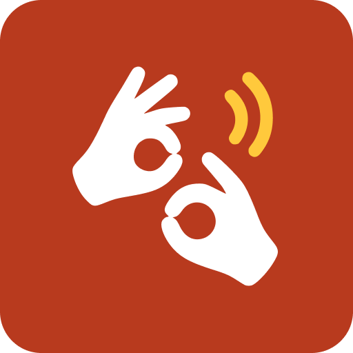 | 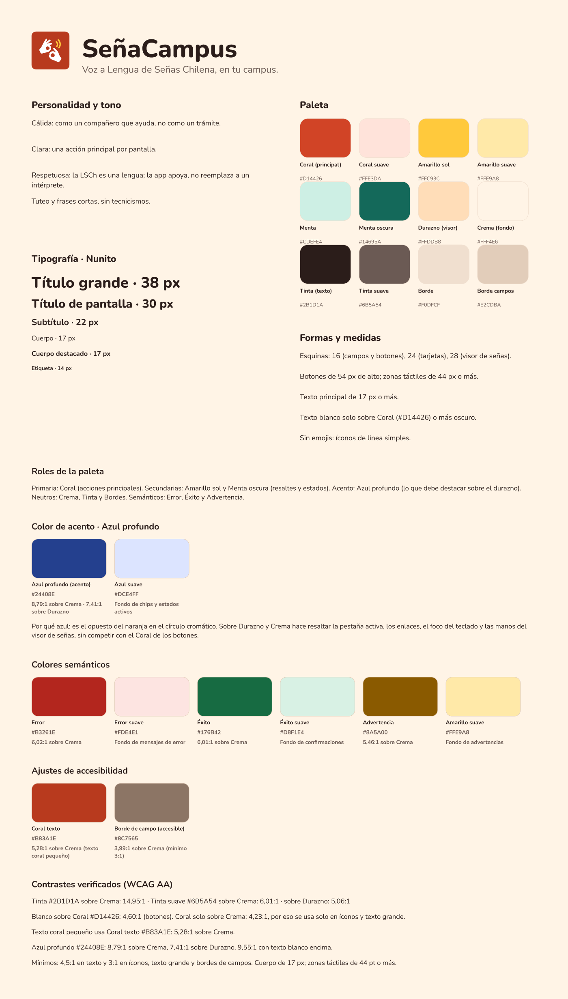 |

### Paleta (estilos de color en Figma = `mobile/src/constants/colores.js`)

| Rol | Nombre | HEX | Uso y contraste (WCAG AA) |
| :--- | :--- | :---: | :--- |
| **Primario** | Coral | `#D14426` | Botón de acción principal. Texto blanco encima: 4,60:1. |
| Primario presionado / texto | Coral texto | `#B83A1E` | Botón primario presionado, texto coral pequeño (5,28:1 sobre Crema). |
| Primario suave | Coral suave | `#FFE3DA` | Estado presionado de tarjetas y botones secundarios. |
| **Secundario** | Amarillo sol / Menta oscura | `#FFC93C` / `#14695A` | Resaltes y estados; ondas del logo. |
| **Acento** | Azul profundo | `#24408E` | Complementario del naranja: hace resaltar la pestaña activa, enlaces, foco y el intérprete sobre el Durazno (8,79:1 sobre Crema, 7,41:1 sobre Durazno). |
| Acento suave | Azul suave | `#DCE4FF` | Cápsula de la pestaña activa, contenedores de íconos, avisos informativos. |
| **Neutros** | Crema · Blanco · Tinta · Tinta suave · Borde · Borde de campo | `#FFF4E6` · `#FFFFFF` · `#2B1D1A` · `#6B5A54` · `#F0DFCF` · `#8C7565` | Fondo cálido que cansa menos que el blanco puro; texto principal 14,95:1 y secundario 6,01:1; borde de campos 3,99:1 (mínimo 3:1). |
| Visor | Durazno | `#FFDDB8` | Fondo del visor de señas. |
| **Semánticos** | Error / Éxito / Advertencia | `#B3261E` / `#176B42` / `#8A5A00` | 6,02:1 / 6,01:1 / 5,46:1 sobre Crema. Con fondos suaves `#FDE4E1` / `#D8F1E4` / `#FFE9A8`. |

### Escala tipográfica (Nunito; estilos de texto en Figma = `mobile/src/constants/tipografia.js`)

| Estilo | Tamaño y peso | Uso |
| :--- | :--- | :--- |
| Título grande | 38 · ExtraBold | Nombre de la app en la pantalla de carga |
| Título de pantalla | 30 · ExtraBold | Título de cada pantalla |
| Subtítulo | 22 · Bold | Títulos de modales y de asignatura en vivo |
| Cuerpo / Cuerpo destacado | 17 · Regular / Bold | Lectura, subtítulos del profesor, botones |
| Secundario | 16 · Regular | Detalles de tarjetas y avisos (el cuerpo nunca baja de 16) |
| Etiqueta | 14 · Bold | Chips, pestañas y rótulos en mayúsculas |

### UI Kit (componentes con estados)
Botón (primario, secundario y texto × normal, presionado, deshabilitado, cargando), Chip (normal, activo, completado, deshabilitado), Interruptor, Campo de texto (normal, foco, error, deshabilitado), Aviso (error, éxito, advertencia, info), Tarjeta, Fila de ajuste, Barra de pestañas, Barra superior, Barra de estado, Visor de señas (señando, deletreo, cargando, sin señal), Burbuja, Estado vacío y Ventana de confirmación. Todos tienen su equivalente en `mobile/src/components/`.

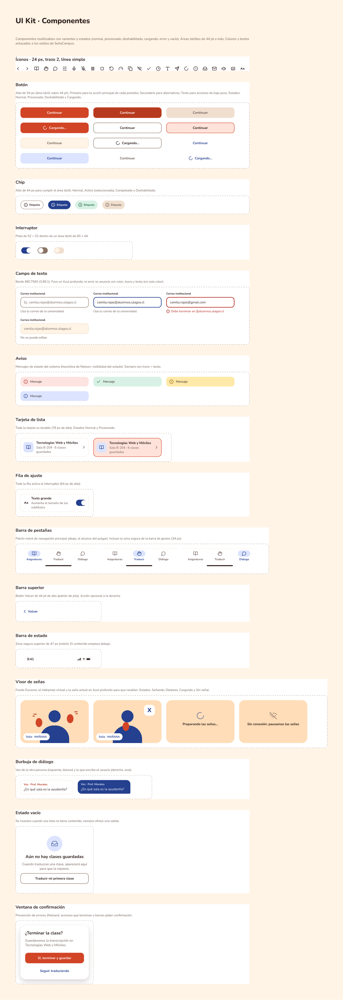

---

## 2. Arquitectura y Flujo de Usuario

### Storyboard del caso de uso principal (5 viñetas)
Camila (personaje de ejemplo que representa a una estudiante sorda) sigue una clase en vivo desde su celular:

1. **Se pierde la clase** — *en el aula, sentada al fondo.* El profesor habla rápido y mira a la pizarra; no alcanza a leer sus labios ni a copiar a la vez.
2. **Abre la app con una mano** — *de pie, con la mochila en la otra mano.* Entra con su correo institucional y toca su asignatura; las acciones quedan abajo, al alcance del pulgar.
3. **Traduce en vivo** — *celular apoyado en el pupitre.* La app escucha al profesor y muestra las señas y los subtítulos con las palabras clave resaltadas.
4. **Se cae la señal** — *Wi-Fi del campus inestable.* La app avisa «Sin conexión», ofrece Reintentar y no pierde lo ya traducido.
5. **Repasa después** — *en el bus, en movimiento y con una mano.* La clase quedó guardada; repasa la transcripción y las palabras deletreadas antes de la prueba.

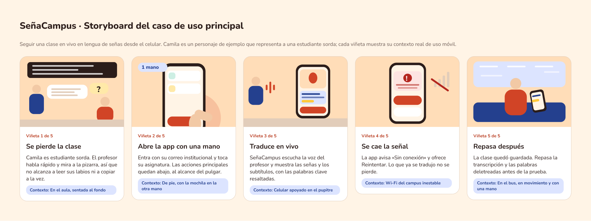

### Mapa de navegación
Tres pestañas inferiores (**Asignaturas**, **Traducir**, **Diálogo**), pilas de pantallas que se abren encima y estados de la traducción (conectando, sin conexión, micrófono bloqueado, palabra sin seña).

### Rutas en la app (Expo Router — `mobile/src/app/`)

    src/app/
    ├── _layout.jsx            # Stack raíz: carga de la fuente Nunito + SafeAreaProvider
    ├── index.jsx              # Acceso (login con correo institucional)
    ├── ajustes.jsx            # Ajustes (se abre desde Asignaturas)
    ├── resumen.jsx            # Resumen de sesión (después de terminar la clase)
    ├── asignatura/[id].jsx    # Ruta dinámica: detalle de asignatura e historial
    ├── clase/[id].jsx         # Ruta dinámica: transcripción guardada
    └── (tabs)/
        ├── _layout.jsx        # Barra de pestañas (respeta la barra de gestos)
        ├── index.jsx          # Pestaña 1: Asignaturas (inicio)
        ├── traducir.jsx       # Pestaña 2: Traducción en clase
        └── dialogo.jsx        # Pestaña 3: Modo diálogo

---

## 3. Evolución Visual (Wireframes vs. Mockups de Alta Fidelidad)

Los wireframes son de baja fidelidad, en escala de grises y en marcos de 390 × 844 pt, con la franja gris inferior que marca la zona fácil de alcanzar con el pulgar. Los mockups usan la paleta, la tipografía y los componentes del UI Kit, con contenido realista.

| Pantalla | Wireframe (baja fidelidad) | Mockup (alta fidelidad) |
| :--- | :---: | :---: |
| **Asignaturas (inicio)** |  |  |
| **Traducción en clase** | 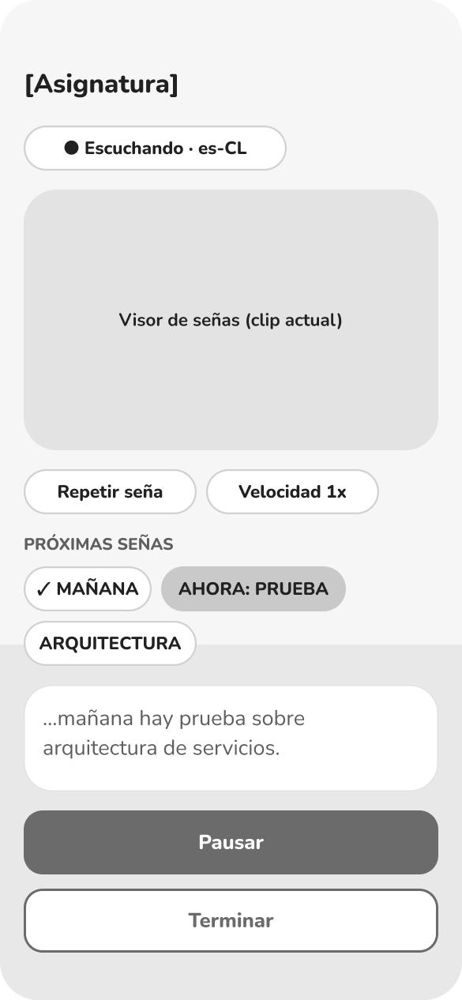 |  |
| **Transcripción guardada** | 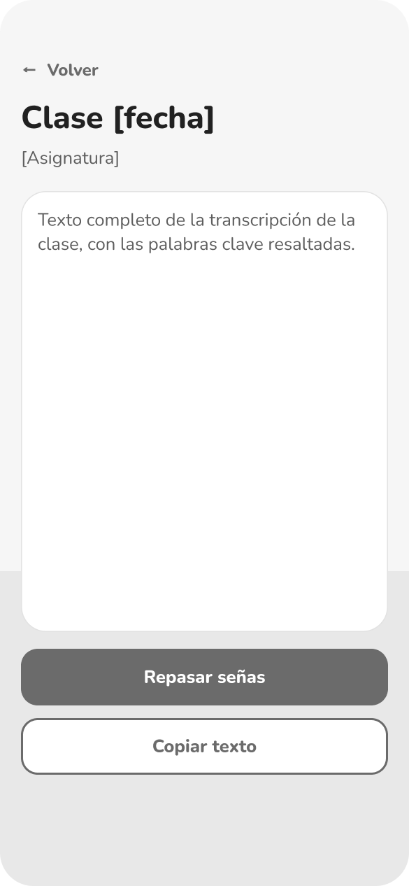 |  |
| **Modo diálogo** | 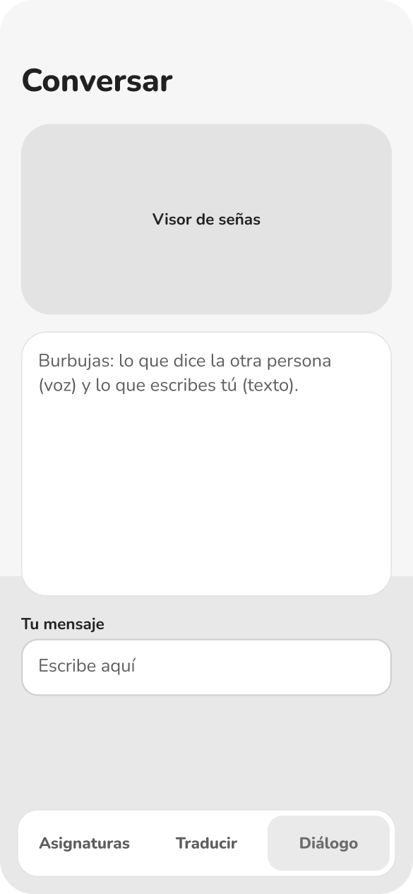 | 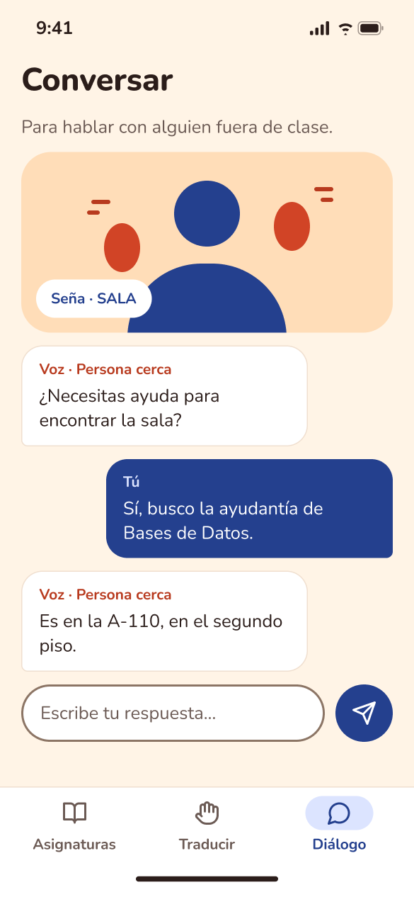 |

Cambios principales entre ambas versiones: el visor de señas pasó de un rectángulo gris a un intérprete en Azul profundo sobre Durazno; los placeholders (`[Nombre]`, `[Asignatura]`) se reemplazaron por datos reales; las acciones principales se agruparon abajo; y los chips se agrandaron a 44 pt para cumplir el área táctil mínima.

---

## 4. Evidencia del Frontend Móvil (capturas en el teléfono)

Capturas tomadas en el teléfono con la app corriendo en **Expo Go**:

| Asignaturas | Traducción en vivo | Confirmar fin de clase | Transcripción guardada |
| :---: | :---: | :---: | :---: |
| 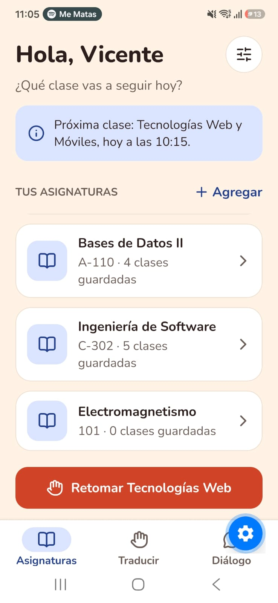 | 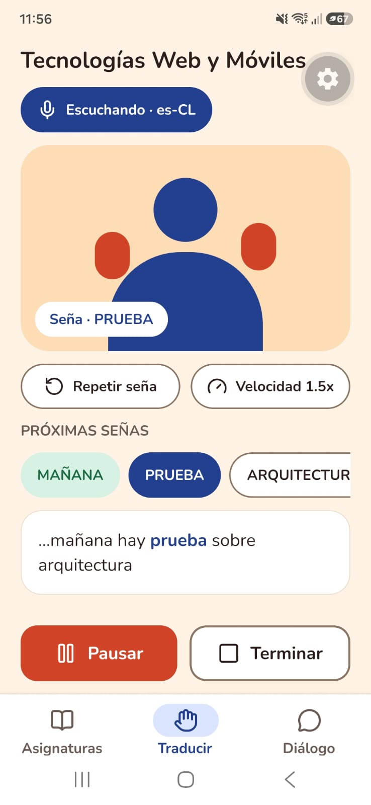 |  |  |

Interacciones reales de cada interfaz:
* **Asignaturas:** lista con `FlatList`; al tocar una tarjeta se navega a `asignatura/[id]` pasando el `id` como parámetro.
* **Traducción en clase:** Pausar/Reanudar detiene o reanuda los subtítulos (`useState` + `setInterval` en `useEffect`); el chip de velocidad rota entre 0.75x, 1x y 1.5x; Terminar abre la ventana de confirmación y luego el resumen.
* **Modo diálogo:** `TextInput` controlado; al enviar se agrega una burbuja a la lista y el botón queda deshabilitado si el campo está vacío.
* **Ajustes:** los interruptores cambian su estado y la velocidad rota al tocarla.

---

## 5. Justificación Técnica y Ergonómica

1. **Una acción principal por pantalla, abajo:** la persona sorda reparte la atención entre el profesor, la pizarra y el celular. Por eso cada pantalla tiene un solo botón Coral (el más visible) y queda en la zona del pulgar, justo encima de la barra de pestañas. Esto reduce la carga cognitiva: no tiene que buscar qué hacer.
2. **Jerarquía en la traducción en vivo:** de arriba hacia abajo va el estado («Escuchando · es-CL»), el visor de señas (lo más grande), los controles (repetir y velocidad), las próximas señas (completada en verde, actual en azul) y los subtítulos con las palabras clave en negrita azul. Lo más importante está donde llega primero la mirada.
3. **Tamaños táctiles:** botones de 54 pt, chips de 44 pt, tarjetas de 76 pt y filas de ajuste de 64 pt; toda el área de la tarjeta o fila es tocable, no solo el texto. Todo supera el mínimo de 44 pt (48 dp).
4. **Zonas seguras:** `SafeAreaView` y `useSafeAreaInsets` evitan el notch y la barra de gestos; la barra de pestañas suma el `inset` inferior.
5. **Heurísticas de Nielsen:**
   * *Visibilidad del estado del sistema:* chip «Escuchando / En pausa», avisos de éxito, error, advertencia e info, y estados presionados en botones y tarjetas.
   * *Prevención de errores:* confirmación antes de terminar la clase; validación del correo institucional; botón de enviar deshabilitado sin texto.
   * *Consistencia:* los mismos componentes en todas las pantallas; colores, tipografía y medidas centralizados en `src/constants/`, iguales a los estilos de Figma.
6. **Accesibilidad del color:** todo texto cumple 4,5:1 y los bordes e íconos 3:1. Los errores se comunican con color, ícono y texto (no solo color).
7. **Rendimiento:** las listas usan `FlatList` con `keyExtractor` en vez de `ScrollView` + `.map()`.

---

## 6. Bitácora de Uso Responsable de IA Generativa

### Herramientas usadas en cada etapa

| Etapa | Herramienta | Para qué |
| :--- | :--- | :--- |
| Logo | *(completar: herramienta de imágenes usada)* | Generar la imagen base del logo |
| Diseño en Figma | **Claude** (con acceso al archivo de Figma) | Revisar el archivo contra la rúbrica; completar la paleta (acento azul, semánticos) y verificar contrastes; crear el UI Kit con variantes y estados, los 16 mockups y el prototipo navegable; vectorizar el logo |
| Frontend | **Gemini** | Migrar la navegación a Expo Router, estructurar pantallas y datos de ejemplo |
| Frontend | **Claude** | Crear componentes que faltaban (`Boton`, `Tarjeta`, `Chip`, `FilaAjuste`, `Logo`), rehacer Acceso y Ajustes según el Figma, comparar app y Figma, limpiar archivos antiguos |
| Documentación | Gemini y Claude | Redactar README y esta bitácora |

### Prompts principales
<!-- Agregar capturas de cada prompt en docs/img/ia-1.png, ia-2.png, etc. -->

1. *«Necesito que me ayudes a editar mi Figma a través de esta rúbrica.»* (Claude, con la rúbrica en PDF) → 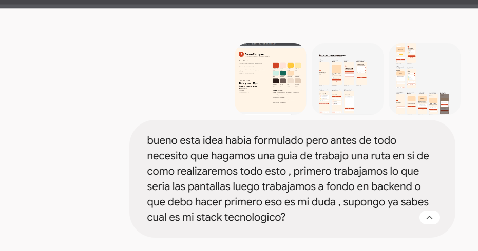
2. *«Agrega un color extra que haga resaltar el color naranja durazno.»* (Claude) → 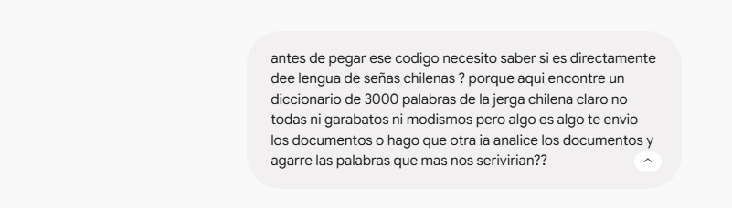
3. *«Analiza la rúbrica del Avance N°1 y reestructura el frontend móvil a Expo Router con `src/app/`, layouts anidados, `FlatList`, `Pressable` y `SafeAreaView`.»* (Gemini) → 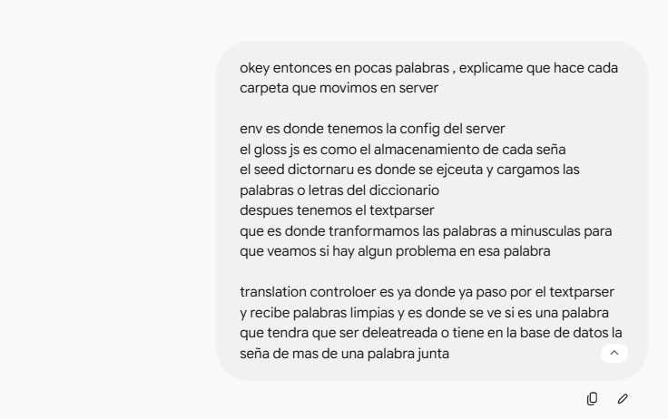
4. *«Actualicé el Figma de SeñaCampus y necesito que el código quede igual al diseño nuevo…»* (Gemini, con la especificación de colores, tipografía y componentes) → 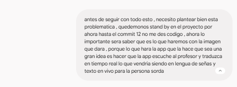

### Qué se aceptó, qué se corrigió y por qué

* **Contrastes que no cumplían WCAG:** el borde de campos `#E2CDBA` daba 1,41:1 y se cambió a `#8C7565` (3,99:1). El verde de éxito daba 4,48:1 sobre su fondo y se oscureció a `#176B42` (5,48:1). Con el fondo del logo en Coral `#D14426`, las ondas amarillas quedaban en 2,99:1, así que se usó Coral texto `#B83A1E` (3,73:1).
* **Errores visuales del diseño generado:** los íconos dentro de los botones naranjos quedaron oscuros en vez de blancos; un chip («ARQUITECTURA») se cortaba; los chips de letras completadas mostraban «ⓘ» en vez de ✓. Se revisaron las capturas y se corrigieron.
* **Validación del logo en LSCh:** la IA advirtió que la forma de las manos se parece a la seña *INTERPRETAR* de la lengua de señas estadounidense (ASL) y que no podía confirmar su significado en LSCh. Por eso el logo se presenta como representación de la conversación en señas, no como una seña específica. *(Completar si se validó con una persona sorda o intérprete.)*
* **Código que no corría:** faltaba instalar `@expo-google-fonts/nunito` y no existían los componentes `Boton`, `Tarjeta` y `Chip` que importaban las pantallas (error *Unable to resolve*). Se instalaron con `npx expo install` y se crearon los componentes con las mismas props que usaban las pantallas.
* **Detalles de lógica:** el botón de ajustes no tenía `onPress`; el saludo tenía el nombre escrito a mano (se movió a `USUARIO` en `mockData.js`); «Volver al inicio» llevaba al login en vez de a Asignaturas.
* **Dependencias de red:** una primera versión cargaba datos desde la API local (IP fija), lo que fallaría en Expo Go durante la defensa. Se dejaron datos de ejemplo en `src/data/mockData.js`, como permite la rúbrica; la conexión con el backend (`src/services/api.js`) queda para el siguiente avance.
* **Limpieza:** se eliminaron archivos del diseño anterior que ya no se usaban (`theme.js`, `ScreenHeader`, `screens/`, `navigation/`, `App.js`, `index.js`, la ruta `sesion/`).
* **PowerShell:** los corchetes de `src/app/asignatura/[id].jsx` se interpretaban como comodines; se usó `-LiteralPath`.
