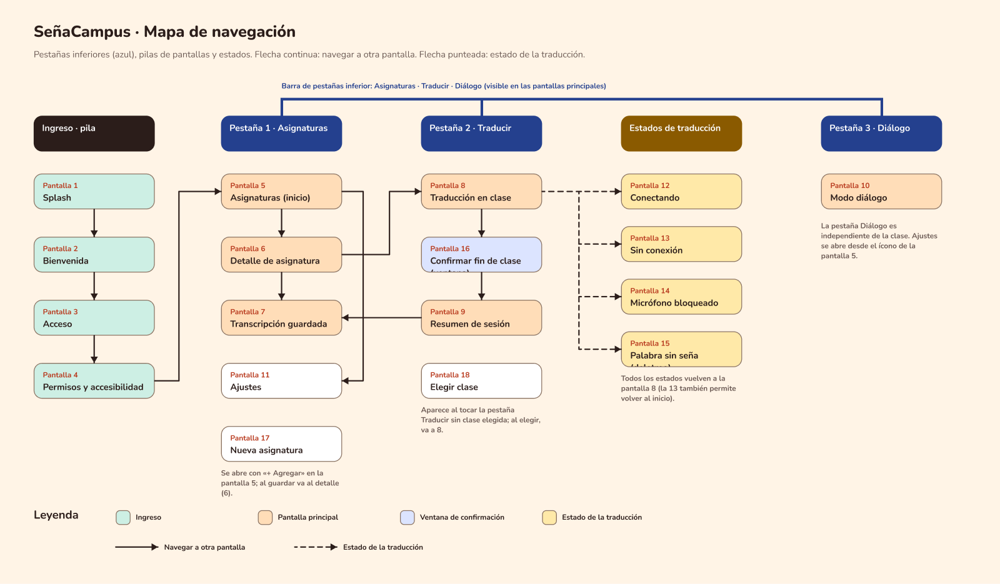
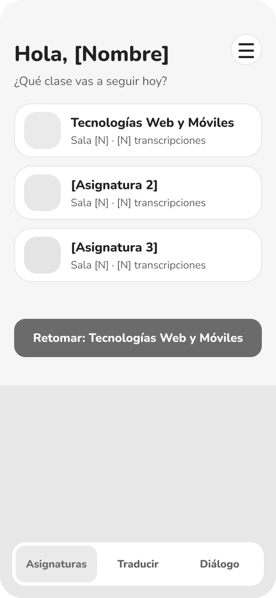
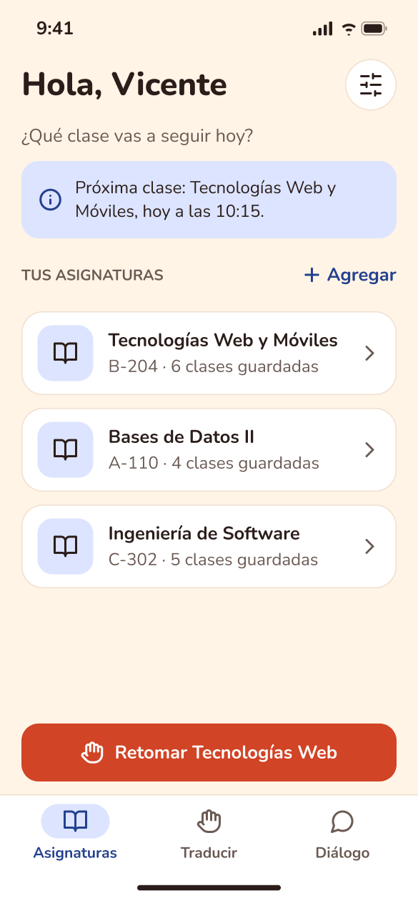
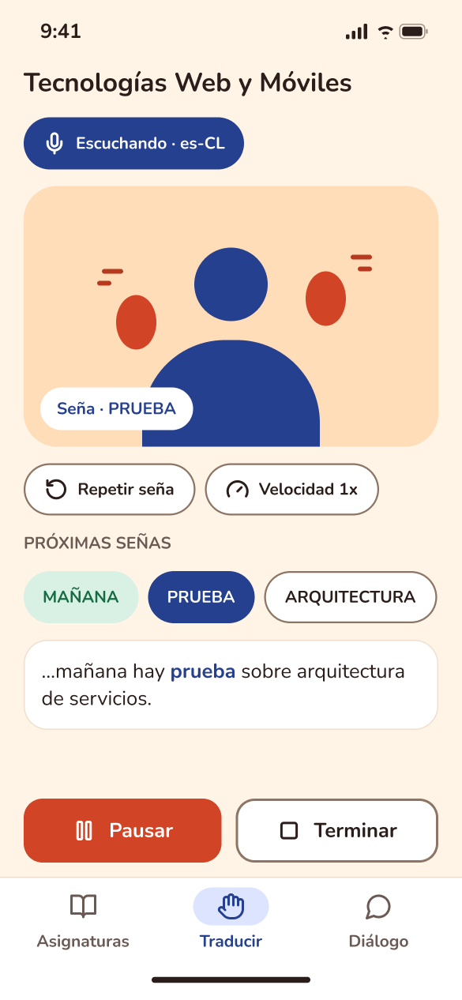
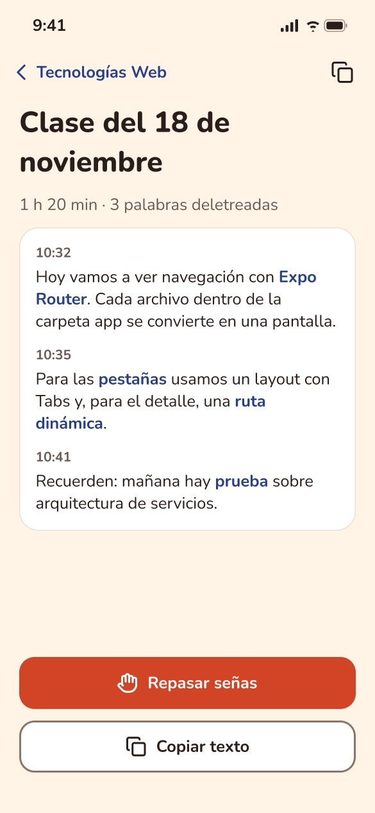

# Bitácora de Diseño UI/UX y Frontend Móvil — SeñaCampus

* **Asignatura:** Tecnologías Web y Móviles (6º semestre) — Ingeniería Civil en Informática, Universidad de Los Lagos
* **Estudiante:** Vicente Martín Garín Pereda
* **Avance:** Avance N°1 — Diseño UI/UX y Frontend Móvil (React Native + Expo SDK 58)
* **Repositorio:** [GitHub — SenaCampus](https://github.com/Vicente-Garin/SenaCampus)
* **Prototipo Figma:** [Abrir Prototipo en Figma](https://www.figma.com/design/bCv8y8gXMaHy6oLUagS4PI/se%C3%B1aCampus?node-id=3-362&t=3c6s7hihCM2XMi2I-1)

---

## 1. Identidad de Marca y UI Kit Base

### Propósito del Nombre y Logo
**SeñaCampus** nace de unir el concepto de **Lengua de Señas Chilena (LSCh)** con el entorno universitario (**Campus**), reflejando su objetivo principal: traducir en tiempo real la voz del docente en sala de clases a glosas y señas comprensibles para estudiantes sordos o hipoacúsicos.

* **Logo vectorial:** Isotipo basado en gestualidad manual y ondas de voz académicas, validado a $48\text{ px}$ para cabecera y adaptado a ícono de aplicación ($1024 \times 1024\text{ px}$) y pantalla de carga (*splash*).
* 

### Paleta Cromática (WCAG AA)
Definida centralizadamente en `mobile/src/constants/theme.js` en concordancia 1:1 con los estilos de Figma para garantizar descansabilidad visual y contraste $\ge 4,5:1$:

| Rol | Token | Código HEX | Contraste / Uso |
| :--- | :--- | :---: | :--- |
| **Primario** | `COLORS.primary` | `#C84626` | Terracota institucional; contraste $5,1:1$ con texto blanco `#FFFFFF` en botones principales. |
| **Primario Suave** | `COLORS.primaryLight` | `#FAD9CF` | Fondos de etiquetas de categoría, badges y estados seleccionados. |
| **Secundario** | `COLORS.secondary` | `#1E3A8A` | Azul marino para indicadores en vivo (`Escuchando · es-CL`), enlaces de navegación y controles secundarios. |
| **Fondo Base** | `COLORS.background` | `#FDF3E7` | Crema cálido que reduce fatiga ocular frente al blanco puro en aulas iluminadas. |
| **Superficie / Tarjeta** | `COLORS.surface` | `#FFFFFF` | Contenedores elevados con borde `#E7DDD0` para jerarquía visual clara. |
| **Texto Principal** | `COLORS.textDark` | `#1C1917` | Contraste $16,4:1$ sobre `#FDF3E7` (cumple AAA). |
| **Texto Secundario** | `COLORS.textSecondary` | `#57534E` | Contraste $7,1:1$ sobre `#FDF3E7` (cumple AA). |
| **Éxito (Semántico)** | `COLORS.success` / `successLight` | `#1E6F50` / `#DCFCE7` | Confirmación de sesión guardada y conectividad activa. |
| **Advertencia (Semántico)** | `COLORS.warning` / `warningLight` | `#9A5B00` / `#FEF3C7` | Estado de espera o pausa temporal. |
| **Error (Semántico)** | `COLORS.error` / `errorLight` | `#B91C1C` / `#FEE2E2` | Validación de formularios y alertas de permiso de micrófono. |

### Escala Tipográfica (`TYPOGRAPHY`)
* **Título Principal (`h1`):** `26 sp`, Bold — Encabezados de pantalla y glosa activa.
* **Subtítulo (`h2`):** `20 sp`, Bold — Títulos de modales y temas de cátedra.
* **Encabezado de Tarjeta (`h3`):** `18 sp`, Bold — Nombres de asignaturas y sesiones guardadas.
* **Cuerpo Base (`body`):** `16 sp`, Regular/SemiBold — Transcripciones del docente y textos de lectura (cumple mínimo $\ge 16\text{ sp}$).
* **Etiquetas (`caption`):** `14 sp`, Bold — Metadatos de sala, fecha y categorías gramaticales.

---

## 2. Arquitectura y Flujo de Usuario

### Storyboard (Caso de Uso Principal en Aula)
1. **Viñeta 1 — Ingreso a sala:** El estudiante llega a su cátedra en el campus con ruido ambiental y el docente comienza a explicar.
2. **Viñeta 2 — Selección de asignatura:** Con una mano en su teléfono, abre **SeñaCampus**, selecciona la asignatura e inicia la traducción en vivo.
3. **Viñeta 3 — Traducción en tiempo real:** La app capta la voz del profesor, despliega los subtítulos y muestra la secuencia de glosas LSCh junto con la cola de próximas señas.
4. **Viñeta 4 — Consulta rápida (Diálogo):** Ante una duda fuera o dentro de clase, cambia a la pestaña **Diálogo** para conversar bidireccionalmente mediante texto y señas.
5. **Viñeta 5 — Guardado y repaso:** Al finalizar presiona **Terminar** o **`‹ Volver`**, confirma **"¿Terminar la clase?"** y luego repasa la transcripción organizada en modo **Solo lectura**.

### Mapa de Navegación (Expo Router — `mobile/src/app/`)

    src/app/
    ├── _layout.jsx                  # Stack Raíz + SafeAreaProvider + SubjectsProvider
    ├── index.jsx                    # Pantalla de Acceso Institucional (Login)
    ├── ajustes.jsx                  # Configuración de Accesibilidad (Subtítulos / Texto grande)
    ├── asignatura/
    │   └── [id].jsx                 # Ruta Dinámica: Detalle de Asignatura e historial de clases
    ├── sesion/
    │   └── [sessionId].jsx          # Ruta Dinámica: Transcripción guardada (Solo lectura)
    └── (tabs)/
        ├── _layout.jsx              # Navegación Inferior (Tabs adaptados a SafeAreaInsets)
        ├── index.jsx                # Tab 1: Asignaturas (inicio)
        ├── traducir.jsx             # Tab 2: Traducción en clase (Voz docente -> LSCh)
        └── dialogo.jsx              # Tab 3: Modo diálogo (Conversar)

---

## 3. Evolución Visual (Wireframes vs. Mockups de Alta Fidelidad)

Comparación entre los wireframes de baja fidelidad en escala de grises y los mockups finales navegables en Figma:

| Pantalla | Wireframe (Baja Fidelidad) | Mockup (Alta Fidelidad) |
| :--- | :---: | :---: |
| **1. Asignaturas (inicio)** |  |  |
| **2. Traducción en clase** |  |  |
| **3. Transcripción guardada** |  |  |
| **4. Modo diálogo** |  |  |

---

## 4. Evidencia del Frontend Móvil (Capturas en Teléfono)

Capturas tomadas directamente desde el dispositivo móvil ejecutando la aplicación en **Expo Go**:

| Asignaturas | Traducción en Vivo | Confirmar Fin de Clase | Clase Guardada (Lectura) |
| :---: | :---: | :---: | :---: |
|  |  |  |  |

---

## 5. Justificación Técnica y Ergonomía Móvil

1. **Reducción de carga cognitiva en aula:** El estudiante sordo divide su atención entre el docente, la pizarra y su pantalla. Por ello, el visor de seña activa ocupa el tercio superior con alto contraste, seguido de controles rápidos (`Repetir seña`, `Velocidad 1x`), una tira horizontal (`FlatList horizontal`) de próximas señas y los subtítulos del profesor debajo.
2. **Separación entre grabación y repaso:** Una clase ya guardada se abre en `sesion/[sessionId].jsx` como documento estructurado de **solo lectura**, eliminando controles de micrófono accidentales durante el estudio. En contraste, una sesión nueva en `traducir.jsx` intercepta **Terminar** y **`‹ Volver`** mediante el modal *"¿Terminar la clase?"* para prevenir pérdida de apuntes (Heurística de Nielsen: *Prevención de errores*).
3. **Ergonomía y zonas seguras (`SafeAreaView` + `useSafeAreaInsets`):**
   * Todas las acciones interactivas (`Pressable`) implementan `minHeight: 48` y `minWidth: 48` ($48\text{ dp}$), ubicando los controles principales (*Pausar*, *Terminar*, barra de pestañas) en la zona inferior al alcance natural del pulgar.
   * La barra de pestañas calcula dinámicamente `useSafeAreaInsets().bottom` para evitar solapamientos con la barra de gestos del sistema operativo.
4. **Rendimiento nativo:** Se reemplazaron renderizados con `ScrollView + .map()` por `FlatList` con `keyExtractor` único para virtualizar listas de asignaturas, bloques transcritos y mensajes.

---

## 6. Bitácora de Uso Responsable de IA Generativa

En cumplimiento con las normas del curso, se declara el uso de **Gemini** como asistente de desarrollo y arquitectura durante el diseño e implementación del Avance N°1:

### Herramientas Utilizadas
* **Gemini (Asistente de Código y Arquitectura):** Apoyo en refactorización de navegación hacia Expo Router, estructuración de tokens de diseño WCAG AA, diseño de estado global con React Context y redacción de documentación técnica.

### Prompts Principales y Validación Crítica Realizada

1. **Refactorización de Navegación (`@react-navigation` -> `Expo Router`):**
   * *Prompt resumido:* *"Analiza la rúbrica del Avance N°1 y reestructura el frontend móvil a Expo Router con `src/app/`, layouts anidados, `FlatList`, `Pressable` y `SafeAreaView`."*
   * *Validación y corrección aplicada:* La primera propuesta mantenía dependencias del servidor backend local (`fetch` a IP local) para cargar asignaturas. Se corrigió desacoplando el frontend hacia datos realistas locales (`src/data/mockData.js`) y `SubjectsContext.jsx` para garantizar ejecución autónoma y sin fallos de red en Expo Go durante la defensa.
2. **Inversión del Flujo Principal y Sincronización 1:1 con Figma:**
   * *Prompt resumido:* *"El flujo principal es que habla el profesor y se traduce al alumno en tiempo real; ajusta la pantalla de traducción, agrega botones de regreso y confirmación de guardado al salir, y sincroniza colores y controles con Figma."*
   * *Validación y corrección aplicada:* Se rediseñó `traducir.jsx` con captura continua simulada (`Escuchando · es-CL`), controles de velocidad (`1x`/`1.5x`) y cola de próximas señas, separando las clases guardadas en modo solo lectura (`sesion/[sessionId].jsx`) e incorporando el modal *"¿Terminar la clase?"* al presionar `‹ Volver` o `Terminar`.
3. **Compatibilidad con Entorno Windows/PowerShell:**
   * *Corrección técnica:* Al generar rutas dinámicas como `src/app/asignatura/[id].jsx` desde PowerShell, los corchetes `[]` provocaban errores de interpretación de comodines; se validó usando `-LiteralPath` y verificando el funcionamiento limpio en Expo Go.
